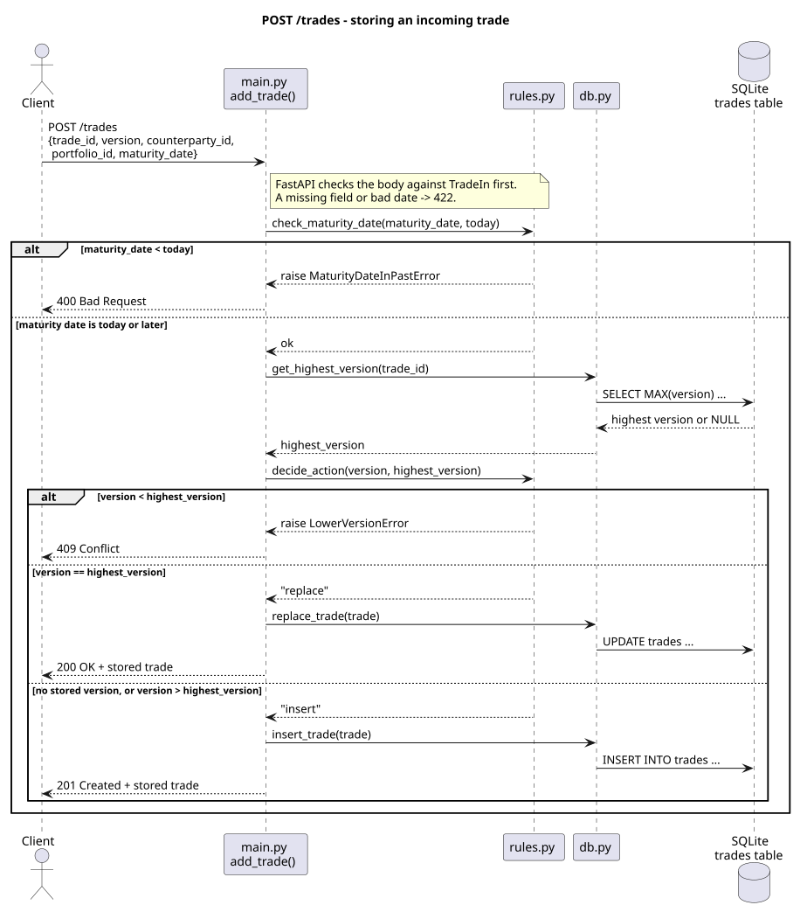
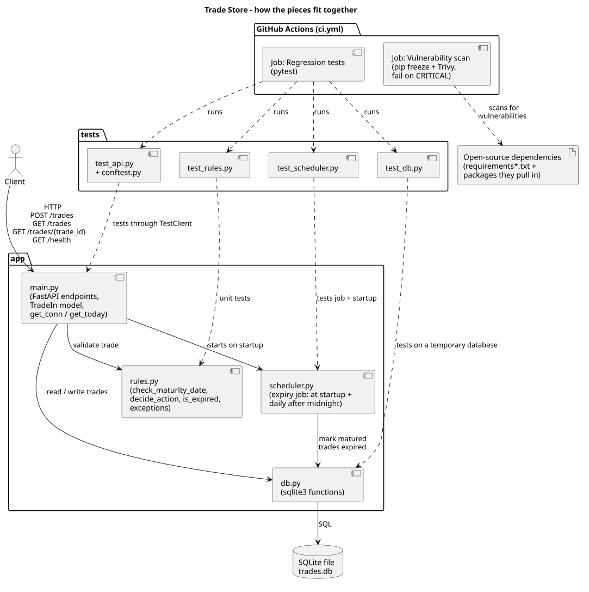

# Trade Store

[](https://github.com/nishantarya4/deutsche-assign/actions/workflows/ci.yml)

A small REST API that receives trades, checks them against business rules and stores them in a SQL database (SQLite).

Built with **Python 3.13**, **FastAPI** and **pytest**, using test-driven development (each test was written and seen failing before the code that makes it pass).

## Business rules

| Rule | What the API does |
|---|---|
| A trade arrives with a **lower version** than one already stored for the same trade id | Rejected: `LowerVersionError`, HTTP **409 Conflict** |
| A trade arrives with the **same version** as the one stored | The stored record is **replaced**, HTTP **200 OK** |
| A trade is new, or has a **higher version** | Stored as a new row (older versions are kept), HTTP **201 Created** |
| The **maturity date is earlier than today** | Rejected: `MaturityDateInPastError`, HTTP **400 Bad Request** |
| A stored trade's **maturity date has passed** | Automatically marked `expired: true` |

A maturity date equal to today is accepted, and that trade is not expired until the next day.

## Project layout

```
app/
  main.py      FastAPI app: request model, endpoints, dependencies (database, today's date)
  rules.py     Business rules as plain functions, plus the two custom exceptions
  db.py        SQLite functions (built-in sqlite3 module)
tests/
  conftest.py  Shared fixtures: fresh temporary database per test, fixed "today"
  test_rules.py
  test_db.py
  test_api.py
docs/diagrams/ PlantUML diagrams
.github/workflows/ci.yml   CI pipeline
```

## Setup

You need Python 3.13.

```powershell
python -m venv .venv
.\.venv\Scripts\Activate.ps1          # Windows PowerShell
# source .venv/bin/activate           # macOS / Linux
pip install -r requirements-dev.txt
```

## Run the tests

```powershell
pytest -v
```

## Run the API

```powershell
uvicorn app.main:app --reload
```

The API starts at http://127.0.0.1:8000, and its interactive documentation is at http://127.0.0.1:8000/docs. The first request creates a `trades.db` file in the folder where you started the server.

## API

| Method | Path | Purpose |
|---|---|---|
| `POST` | `/trades` | Submit one trade |
| `GET` | `/trades` | All trades, ordered by trade id, then highest version first |
| `GET` | `/trades/{trade_id}` | All versions of one trade, highest version first (404 if unknown) |
| `GET` | `/health` | Returns `{"status": "ok"}` |

Dates use ISO format (`YYYY-MM-DD`). The server sets `created_date` to today and works out `expired`.

**Submit a trade:**

```bash
curl -X POST http://127.0.0.1:8000/trades \
  -H "Content-Type: application/json" \
  -d '{"trade_id": "T1", "version": 1, "counterparty_id": "CP-1", "portfolio_id": "B1", "maturity_date": "2027-05-20"}'
```

**Response (201):**

```json
{
  "trade_id": "T1",
  "version": 1,
  "counterparty_id": "CP-1",
  "portfolio_id": "B1",
  "maturity_date": "2027-05-20",
  "created_date": "2026-11-07",
  "expired": false
}
```

**Errors** use the form `{"detail": "<message>"}`, for example:

```json
{"detail": "Trade T1: Version 1 is lower than stored version 2"}
```

A body with a missing field or an invalid date gets **422** with FastAPI's standard validation details.

## Design decisions

- **SQLite through Python's built-in `sqlite3`.** It's a real SQL database with no server to install. The primary key `(trade_id, version)` keeps every version of a trade as its own row, matching the problem statement, where T2 has versions 1 and 2.
- **Rules kept apart from storage.** `rules.py` has no database or web code, so each rule is tested on its own with plain values.
- **"Today" is a dependency.** The endpoints never read the clock directly; they receive `today` from `get_today()`. Tests replace it with a fixed date, so they never depend on the real date.
- **Expiry is checked on every read.** Both GET endpoints mark matured trades as expired before returning data, so the `expired` flag is always current and no background scheduler is needed.
- **Ordering.** Trade ids are sorted as text, so `T10` comes before `T2`.

## CI pipeline (GitHub Actions)

[.github/workflows/ci.yml](.github/workflows/ci.yml) runs two jobs:

1. **Regression tests:** installs the dependencies on Python 3.13 and runs `pytest`. Any failing test fails the build.
2. **Open-source vulnerability scan:** installs the dependencies, writes the full list of installed packages (including the ones pulled in indirectly) with `pip freeze`, and scans it with [Trivy](https://github.com/aquasecurity/trivy). All findings are listed in the log, and the **build fails if any CRITICAL vulnerability is found**.

All actions are pinned to exact commit hashes.

**When it runs:**

- On every push and every pull request.
- **On demand:** open the [Actions tab](https://github.com/nishantarya4/deutsche-assign/actions/workflows/ci.yml), click **Run workflow**, choose a branch and click **Run workflow** again.
- **Weekly:** every Monday at 06:00 UTC, so a vulnerability published after the last push still fails a build. GitHub pauses scheduled runs in a public repository after 60 days without activity; a push or a manual run turns them back on.

**Checking the result:**

- The badge at the top of this README shows whether the latest build on `main` passed.
- In a build, the **Open-source vulnerability scan** job shows three steps: **List every installed package** (what was scanned), **Report all known vulnerabilities** (all findings), and **Fail the build on CRITICAL vulnerabilities** (the gate).

## Diagrams

### POST /trades: every path through the endpoint



### How the pieces fit together



The PlantUML source for each diagram is next to its image in [docs/diagrams](docs/diagrams): [sequence_add_trade.puml](docs/diagrams/sequence_add_trade.puml) and [components.puml](docs/diagrams/components.puml).

**Updating a diagram:**

1. Edit the `.puml` file.
2. Preview it, either by pasting it into https://www.plantuml.com/plantuml or with the VS Code **PlantUML** extension (`Alt+D`).
3. Export the new `.svg` from the preview, replace the old one, and commit both files.
